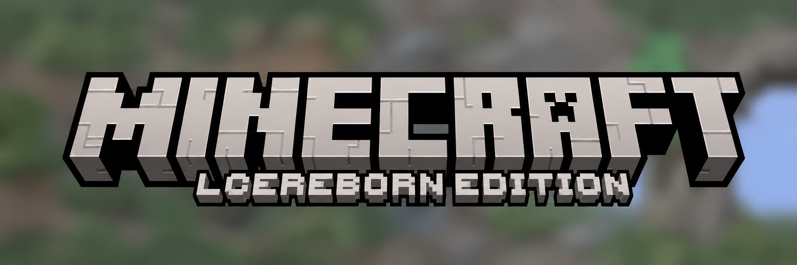

**Legacy Console Edition with Live accounts and online play on Windows, Linux, Nintendo Switch (Beta), and Wii U (Beta).**

[English](#en) · [Русский](#ru) · [Website](https://lcereborn.xyz) · [Downloads](https://github.com/LCEReborn-Live/LCEReborn/releases/latest) · [LiveAPI](https://github.com/LCEReborn-Live/LiveAPI)

## English
   
**LCEReborn Live** adds Live accounts, friends, online worlds and mini-games to LCEReborn. The game is based on the reconstructed Minecraft: Wii U Edition source for the Aquatic Update 1.13.

### PC features

- Browser-based Live sign-in with a persistent launcher session.
- In-game **LCE Live** menu for friends, friend requests, invitations, presence, and available worlds.
- View friends' shared achievements in their in-game profiles. Existing achievements sync when their owner plays while signed in to Live.
- Manage your account and friends on the [Live website](https://lcereborn.xyz); a link to an available friend's world opens the launcher.
- Invitation and friend request notifications in game or in the launcher; the launcher can stay in the system tray for background notifications.
- Battle, Tumble and Glide activity indicators for friends on the website.
- Live matchmaking for Battle, Tumble, Glide, and Build games with compatible open sessions.
- Direct connections with NAT traversal when possible, with relay fallback.
- Live account skins and capes in game.
- The original LCE leaderboard menu with global, friends, and personal score filters.
- A launcher news feed for both LCEReborn Live and original LCEReborn releases.
- Update notifications on Windows and Linux; installed Windows copies can run the installer, while Linux opens the new AppImage for download.
- A focused mini-game Join tab for Battle, Tumble, and Glide matchmaking.
- Wii U-style open-mic Game Chat in online play, with local microphone noise suppression, automatic voice activity detection and no push-to-talk key.
- Keyboard, mouse, and controller support; single-player and split-screen play.

### Install on PC

Hosting a world? Separate **Windows and Linux dedicated-server packages** are also produced for releases. See [server setup](docs/dedicated-server.md).

1. Download the installer, portable archive, or Linux AppImage from the [releases page](https://github.com/LCEReborn-Live/LCEReborn/releases/latest).
2. Start the launcher and choose **Download & install**, or import **your own dumps** of the base game and Update 688.
3. Sign in to Live from the launcher, choose a profile, and select **Play**.

The PC launcher prepares game data during first-run setup and stores your saves locally. [Game data installation](docs/game-downloads.md)

### Install on Nintendo Switch or Wii U (Beta)

Download the full build for your console from [Releases](https://github.com/LCEReborn-Live/LCEReborn/releases). Both full builds include the base game data and Update 688.

| Platform | File | How to start |
| --- | --- | --- |
| Nintendo Switch | `LCEReborn-Full.nro` | Copy it to `switch/` on the SD card and open it from the Homebrew Menu in application mode. In an emulator, put the NRO on its virtual SD card. [Switch guide](docs/switch-building.md) |
| Wii U | `LCEReborn-WiiU-Full-Beta-*.wuhb` | Copy it to `wiiu/apps/` on an Aroma SD card, or open it in Cemu with `python tools/launch_cemu.py --bundle "<file>.wuhb"`. [Wii U guide](docs/building.md) |

Open **LCE Live** in the game's main menu and enter the displayed code on your phone or PC. Your sign-in is saved for the next launch. Friends can see **Playing on Nintendo Switch** or **Playing on Wii U** when you're in a world or mini-game. [Enter your code](https://lcereborn.xyz/authorize)

Relay crossplay, movement corrections and full online Battle, Tumble and Glide rounds are still being tested on consoles. [Release notes](docs/releases/v1.2.7.md)

### Live networking

Sign in to Live in the launcher, add friends by username in the in-game LCE Live menu or on the website, and open a world with online play enabled. Friends' available worlds appear in game automatically. Mini-game matchmaking searches visible Live sessions for a compatible open game. The client uses a direct connection when NAT traversal succeeds and falls back to the relay otherwise. Matchmaking currently searches open games; it does not keep players in a waiting queue.

The launcher News page combines LCEReborn Live release notes with the original LCEReborn release feed. When a newer stable Live release is available, the launcher offers an update; installed Windows copies can download and start the installer from the launcher, while Linux opens the AppImage download. Portable copies use the release page. In an online game, enabling **Game Chat** opens the default microphone and sends speech to the other players; silence is filtered automatically.

The game host limits each player's voice stream to 75 packets and 16384 audio bytes per second, with a short burst allowance. Server operators can set `LCE_VOICE_MAX_PACKETS_PER_SECOND` and `LCE_VOICE_MAX_BYTES_PER_SECOND` before starting the game or dedicated server.

### Build from source

See the build guides for [Windows and Linux](docs/pc-platform.md), [Nintendo Switch](docs/switch-building.md), and [Wii U](docs/building.md). Release build details are in [`docs/live-release.md`](docs/live-release.md). The separate server and website are maintained in [LiveAPI](https://github.com/LCEReborn-Live/LiveAPI).

## Disclaimers

LCEReborn is a community reconstruction project and is not affiliated with or endorsed by Mojang Studios, Microsoft, 4J Studios, or Nintendo. Minecraft is a trademark of Mojang Studios and Microsoft; Wii U is a trademark of Nintendo.

## Special thanks

Special thanks to the team and contributors behind **[LCEReborn](https://github.com/LCEReborn/LCEReborn)**. LCEReborn Live is a fork of their project, and their work on the PC port is the foundation for our client and Live integration.

## Credits and license

LCEReborn code is licensed under the [GNU GPL v3 or later](LICENSE). Third-party components retain their respective licenses.

## Русский

**LCEReborn Live** добавляет в LCEReborn аккаунты Live, друзей, сетевые миры и мини-игры. Основа игры — восстановленный исходный код Minecraft: Wii U Edition на версии Aquatic Update 1.13.

### Возможности на ПК

- Вход в Live через браузер с сохранением сессии в лаунчере.
- Меню **LCE Live** в игре: друзья, заявки, приглашения, статусы и доступные миры.
- Просмотр достижений друзей в их игровых профилях. Полученные ранее достижения синхронизируются, когда их владелец запускает игру с входом в Live.
- Управление аккаунтом и друзьями на [сайте Live](https://lcereborn.xyz); ссылка на доступный мир друга открывает лаунчер.
- Уведомления о приглашениях и заявках в игре или лаунчере; лаунчер может оставаться в системном трее и получать уведомления в фоне.
- Индикаторы активности друзей в Battle, Tumble и Glide на сайте.
- Подключение напрямую с обходом NAT, когда это возможно, и через relay в остальных случаях.
- Скины и плащи Live-аккаунта в игре.
- Оригинальное меню таблиц рекордов LCE с глобальными результатами, результатами друзей и личным рекордом.
- Лента новостей с релизами LCEReborn Live и оригинального LCEReborn.
- Уведомления об обновлениях для Windows и Linux; установленная версия Windows может скачать и запустить установщик.
- Вкладка Join с поиском игр Battle, Tumble и Glide.
- Голосовой Game Chat в стиле Wii U: открытый микрофон в сетевой игре с шумоподавлением и автоматическим определением речи, без кнопки PTT.
- Клавиатура, мышь и геймпады; одиночная игра и разделённый экран.

### Установка на ПК

Для хостинга мира также собираются отдельные **dedicated-серверы для Windows и Linux**. Подробнее: [настройка сервера](docs/dedicated-server.md).

1. Скачайте установщик, portable-архив или Linux AppImage со [страницы релизов](https://github.com/LCEReborn-Live/LCEReborn/releases/latest).
2. Запустите лаунчер и выберите **Download & install** или импортируйте **собственные дампы** базовой игры и Update 688.
3. Войдите в Live через кнопку в лаунчере, выберите профиль и нажмите **Play**.

При первом запуске лаунчер подготовит игровые данные. Сохранения хранятся локально. [Установка игровых данных](docs/game-downloads.md)

### Установка на Nintendo Switch и Wii U (Beta)

Скачайте полный файл для своей консоли со [страницы релизов](https://github.com/LCEReborn-Live/LCEReborn/releases). В оба полных файла входят данные базовой игры и Update 688.

| Платформа | Файл | Как запустить |
| --- | --- | --- |
| Nintendo Switch | `LCEReborn-Full.nro` | Скопируйте файл в `switch/` на SD-карте и запустите его из Homebrew Menu в режиме приложения. В эмуляторе используйте виртуальную SD-карту. [Инструкция для Switch](docs/switch-building.md) |
| Wii U | `LCEReborn-WiiU-Full-Beta-*.wuhb` | Скопируйте файл в `wiiu/apps/` на SD-карте для Aroma или запустите его в Cemu командой `python tools/launch_cemu.py --bundle "<файл>.wuhb"`. [Инструкция для Wii U](docs/building.md) |

Откройте **LCE Live** в главном меню игры и введите код с экрана на телефоне или ПК. Вход сохранится после перезапуска. Когда вы в мире или мини-игре, друзья увидят **Playing on Nintendo Switch** или **Playing on Wii U**. [Ввести код](https://lcereborn.xyz/authorize)

На консолях ещё проверяем кроссплей через Relay, откаты позиции и прохождение полных онлайн-раундов Battle, Tumble и Glide. [Заметки к релизу](docs/releases/v1.2.7.md)

### Сеть Live

Войдите в Live в лаунчере, добавьте друзей по имени пользователя в игровом меню LCE Live или на сайте и откройте мир с включённой сетевой игрой. Доступные миры друзей появляются в игре автоматически. Поиск мини-игр ищет совместимые открытые сессии без очереди ожидания. Прямое соединение используется, когда удаётся пройти NAT; иначе подключение идёт через relay.

Вкладка News объединяет заметки о релизах LCEReborn Live и ленту оригинального LCEReborn. Когда выходит новая стабильная версия Live, лаунчер предлагает обновление. Установленные версии Windows могут скачать и запустить установщик из лаунчера; для portable-версии открывается страница релиза, а для Linux — загрузка AppImage. Включите **Game Chat** в настройках звука во время сетевой игры: микрофон будет открыт, тишина автоматически отфильтровывается.

### Сборка из исходников

Инструкции по сборке есть для [Windows и Linux](docs/pc-platform.md), [Nintendo Switch](docs/switch-building.md) и [Wii U](docs/building.md). Сведения о сборке релизов находятся в [`docs/live-release.md`](docs/live-release.md). Сервер и сайт находятся в отдельном репозитории [LiveAPI](https://github.com/LCEReborn-Live/LiveAPI).

### Отдельная благодарность

Спасибо команде и участникам **[LCEReborn](https://github.com/LCEReborn/LCEReborn)**. LCEReborn Live — форк этого проекта: их работа над PC-портом стала основой нашего клиента и интеграции Live.

### Благодарности и лицензия

LCEReborn основан на восстановленном коде Minecraft: Wii U Edition и других открытых компонентах. Проект не связан с Mojang Studios, Microsoft, 4J Studios или Nintendo и не одобрен ими. Minecraft — товарный знак Mojang Studios и Microsoft; Wii U — товарный знак Nintendo.

Код LCEReborn распространяется по лицензии [GNU GPL v3 или новее](LICENSE). Сторонние компоненты распространяются по своим лицензиям.

## Contributors

- [@kkerneldev](https://github.com/kkerneldev)
