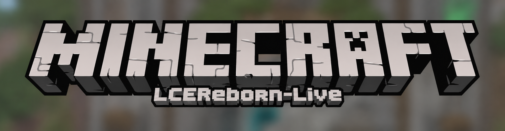

# LCEReborn Live

**Minecraft: Wii U Edition, rebuilt for PC and connected with friends.**

[English](#en) · [Русский](#ru) · [Downloads](https://github.com/LCEReborn-Live/LCEReborn/releases/latest)

## English

**LCEReborn Live** is the PC version of LCEReborn with Live accounts and online features. The game is based on the reconstructed Minecraft: Wii U Edition source, corresponding to the Aquatic Update 1.13.

### Features

- Browser-based Live sign-in with a persistent launcher session.
- Friends, launcher and in-game presence, invitations, and a list of joinable worlds.
- Live matchmaking for Battle, Tumble, Glide, and Build games with compatible open sessions.
- Direct connections with NAT traversal when possible, with relay fallback.
- Live account skins and capes in game.
- The original LCE leaderboard menu with global, friends, and personal score filters.
- A launcher news feed for both LCEReborn Live and original LCEReborn releases.
- Update notifications and in-launcher installer downloads for installed Windows copies.
- A focused mini-game Join tab for Battle, Tumble, and Glide matchmaking.
- Wii U-style open-mic Game Chat in online play, with local microphone noise suppression, automatic voice activity detection and no push-to-talk key.
- Keyboard, mouse, and controller support; single-player and split-screen play.

### Installation

1. Download the installer or portable archive from the [releases page](https://github.com/LCEReborn-Live/LCEReborn/releases/latest).
2. Start the launcher and import **your own dumps** of the base game and Update 688.
3. Sign in to Live from the launcher, choose a profile, and select **Play**.

Game data, saves, and update files are not included in downloads. The launcher imports the files from your own copy of the game.

### Live networking

Sign in to Live in the launcher, add friends by username, and open a world with online play enabled. Friends' available worlds appear in game automatically. Mini-game matchmaking searches visible Live sessions for a compatible open game. The client uses a direct connection when NAT traversal succeeds and falls back to the relay otherwise. Matchmaking currently searches open games; it does not keep players in a waiting queue.

The launcher News page combines LCEReborn Live release notes with the original LCEReborn release feed. When a newer stable Live release is available, the launcher offers an update; installed Windows copies can download and start the installer from the launcher. Portable copies use the release page. In an online game, enabling **Game Chat** opens the default microphone and sends speech to the other players; silence is filtered automatically.

The game host limits each player's voice stream to 75 packets and 16384 audio bytes per second, with a short burst allowance. Server operators can set `LCE_VOICE_MAX_PACKETS_PER_SECOND` and `LCE_VOICE_MAX_BYTES_PER_SECOND` before starting the game or dedicated server.

### Build from source

Client build instructions are in [`docs/pc-platform.md`](docs/pc-platform.md). Release build details are in [`docs/live-release.md`](docs/live-release.md).

## Disclaimers

LCEReborn is a community reconstruction project and is not affiliated with or endorsed by Mojang Studios, Microsoft, 4J Studios, or Nintendo. Minecraft is a trademark of Mojang Studios and Microsoft; Wii U is a trademark of Nintendo.

## Credits and license

LCEReborn code is licensed under the [GNU GPL v3 or later](LICENSE). Third-party components retain their respective licenses. Game files and assets are not included in this repository or installer.

## Русский

**LCEReborn Live** — PC-версия проекта LCEReborn с учётными записями и сетевыми функциями Live. Основа игры — восстановленный исходный код Minecraft: Wii U Edition на версии Aquatic Update 1.13.

### Возможности

- Вход в Live через браузер с сохранением сессии в лаунчере.
- Друзья, статусы «в лаунчере» и «в игре», приглашения и список доступных миров.
- Подключение напрямую с обходом NAT, когда это возможно, и через relay в остальных случаях.
- Скины и плащи Live-аккаунта в игре.
- Оригинальное меню таблиц рекордов LCE с глобальными результатами, результатами друзей и личным рекордом.
- Лента новостей с релизами LCEReborn Live и оригинального LCEReborn.
- Уведомления об обновлениях и загрузка установщика из лаунчера для установленной версии Windows.
- Вкладка Join с поиском игр Battle, Tumble и Glide.
- Голосовой Game Chat в стиле Wii U: открытый микрофон в сетевой игре с шумоподавлением и автоматическим определением речи, без кнопки PTT.
- Клавиатура, мышь и геймпады; одиночная игра и разделённый экран.

### Установка

1. Скачайте установщик или portable-архив со [страницы релизов](https://github.com/LCEReborn-Live/LCEReborn/releases/latest).
2. Запустите лаунчер и импортируйте **собственные дампы** базовой игры и Update 688.
3. Войдите в Live через кнопку в лаунчере, выберите профиль и нажмите **Play**.

Игровые данные, сохранения и файлы обновления не входят в загрузки. Лаунчер импортирует файлы вашей копии игры с компьютера.

### Сеть Live

Войдите в Live в лаунчере, добавьте друзей по имени пользователя и откройте мир с включённой сетевой игрой. Доступные миры друзей появляются в игре автоматически. Прямое соединение используется, когда удаётся пройти NAT; иначе подключение идёт через relay.

Вкладка News объединяет заметки о релизах LCEReborn Live и ленту оригинального LCEReborn. Когда выходит новая стабильная версия Live, лаунчер предлагает обновление. Установленные версии Windows могут скачать и запустить установщик из лаунчера; для portable-версии открывается страница релиза. Включите **Game Chat** в настройках звука во время сетевой игры: микрофон будет открыт, тишина автоматически отфильтровывается.

### Сборка из исходников

Инструкции по сборке клиента находятся в [`docs/pc-platform.md`](docs/pc-platform.md), а сведения о сборке релизов — в [`docs/live-release.md`](docs/live-release.md).

### Благодарности и лицензия

LCEReborn основан на восстановленном коде Minecraft: Wii U Edition и других открытых компонентах. Проект не связан с Mojang Studios, Microsoft, 4J Studios или Nintendo и не одобрен ими. Minecraft — товарный знак Mojang Studios и Microsoft; Wii U — товарный знак Nintendo.

Код LCEReborn распространяется по лицензии [GNU GPL v3 или новее](LICENSE). Лицензии сторонних компонентов остаются за их авторами. Игровые файлы и ресурсы в репозитории и установщике отсутствуют.

## Contributors

- [@kkerneldev](https://github.com/kkerneldev)
